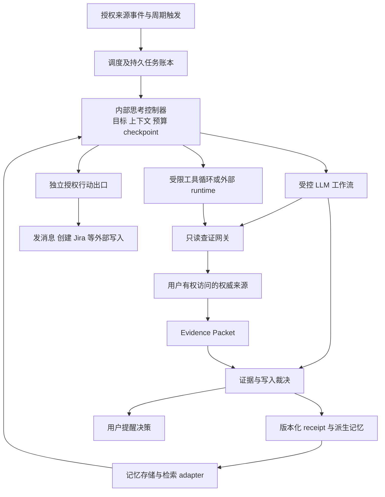

# 记忆系统的内化思考、外部查证与 Mem0 替换边界

研究日期与所有外部来源访问日期：2026-10-29。任务：E-139。状态：研究建议，未实施、未迁移、未部署。先审查行业机制，再映射 Personal AI；不以当前执行器设计为前提。本文的实验阈值是建议值，不是已取得的结果。

## 1. 决策结论

**Personal AI 应拥有内部思考职责，但不必把通用 Agent 嵌进记忆存储进程。** 推荐一个由记忆中心控制的思考层：常规整理用受控 LLM 工作流，需要动态选择证据时使用有限工具循环，长时间或需要专用环境的工作交给独立 runtime。三种执行方式共享证据、预算、权限和写回契约。

**换用 Mem0 仍需要这一层，但自建范围取决于版本。** 当前 Mem0 Platform 已提供 Dream；不能再笼统说“Mem0 不做后台整理”。当前 OSS 没有 Dream，且其主分支已经不是 2025 年论文所描述的写入流程。托管 Dream 能替代部分归并、旧事实标记与模式提炼；没有公开证据表明它会替 Personal AI 自主查询 Jira、管理查证权限或保证事实已获权威证实。[Mem0 Dream](https://docs.mem0.ai/platform/features/dream)、[版本比较](https://docs.mem0.ai/platform/platform-vs-oss)。

**现在不建议直接更换基座。** 先验证“证据缺口→只读查证→可回滚写回”是否提高真实使用质量，同时将存储适配做成研究契约。只有 Mem0 在同一数据、同一权限与成本口径下表现出明确收益，且能保留来源与撤销能力，再决定迁移。这个结论不是维护现状：外部任务生命周期与内部记忆思考仍应拆开拥有。

置信度：职责分离建议高；受控流程作为初始默认中高；Mem0 是否值得迁移中低，缺少本项目对照实验；用户所见某次 Dot Ticket 通知的内部触发方式未知。

已知约束：私人记忆、内部自主整理、避免逐条人工审核、已有来源与时间语义需求；外发、破坏性操作、跨权限访问及高责任画像写入单独治理。未知：实际每人日增量、重点来源的变更事件能力、可接受预算、托管数据条件、目标 Mem0 套餐与部署版本。以下方案可先用合成或脱敏回放验证，不依赖取得这些未知项后才开始研究。

## 2. 不把七种行为都叫作 Agent

本文用“工作流”指代码决定步骤与终止条件；用“工具循环”指模型根据观察选择下一次工具；用“runtime”指执行、隔离与生命周期承载设施。“长期存在的记忆身份”不等于“一个进程永远保持思考”。

| 行为 | 最小可行机制（设计建议） | 何时需要工具循环 | 是否需要长期运行的 Agent |
|---|---|---|---|
| 抽取 | 输入分段、一次结构化 LLM 抽取、校验引用与类型 | 原文缺失且允许回查来源 | 不需要 |
| 去重 | 来源事件 ID/hash 幂等；候选召回后语义判等 | 多来源身份无法直接解析 | 不需要；相似不等于同一事实 |
| 更新 | 同实体同属性的版本比较；冲突保留；确定性写入 | 有多项冲突须按结果继续取证 | 不需要常驻；单个 API 查询也可完全固定 |
| 归并 | 聚类→带引用摘要→信息保留检查→派生版本 | 跨材料组织任务超出固定结构 | 默认不需要 |
| 遗忘 | 排序降权、检索隐藏、保留期删除分别处理 | 模型可建议价值，不必获得删除权 | 不需要；原文删除不能等同摘要替换 |
| 反思 | 选取经历/失败反馈→提出问题→检索→形成带证据结论 | 下一步取决于未知信息和前次工具结果 | 按需有限运行即可 |
| 做梦 | 离线重放/跨记忆联想/预计算，写入 hypothesis 或派生摘要 | 联想产生值得验证的可证伪问题 | 不需要无限循环；“梦”不是统一算法 |

固定流程可以多次调用 LLM，也可以调用 Jira 等工具；有工具不意味着控制权交给模型。反思可以只研究已知记忆，做梦可以只产生联想，都不要求向外访问。向外查询是单独的能力和授权边界。

## 3. 论文证据：支持什么，不支持什么

| 研究 | 可借鉴的机制 | 证据类型与不能外推的部分 |
|---|---|---|
| Generative Agents，Park 等，2023，v2 | 记忆流、按近期性/重要性/相关性检索；累积重要性触发反思；从检索材料形成高层见解并关联支持记忆 | 论文与模拟环境消融支持反思对行为可信度的作用；不是现实 Ticket 真值评测，也未证明反思必须作为通用自主 Agent 常驻。[原文](https://arxiv.org/html/2304.03442v2) |
| Reflexion，Shinn 等，2023，v4 | 将任务反馈转成文字反思，保存在情景缓冲区，供下一次尝试使用 | 任务试错与反馈实验；反馈可以外部或内部产生。自我评价并不自动成为独立证据。[论文](https://arxiv.org/abs/2303.11366v4) |
| MemGPT，Packer 等，2024 修订，v2 | 模型通过记忆操作管理有限上下文与外部记忆层 | 支持 Agent 自主管理上下文这一可行路径；不要求所有记忆系统采用，也不证明具有 Jira 事实刷新能力。[论文](https://arxiv.org/abs/2310.08560v2) |
| Sleep-time Compute，Lin 等，2025，v1 | 在查询到来前预计算有用上下文，并跨后续查询摊销 | 实验主要是改造后的数学任务及 SWE 个案；收益受查询可预测性影响。不能把减少在线推理直接宣称为降低私人记忆系统总成本。[原文](https://arxiv.org/html/2504.13171v1) |
| Mem0，Chhikara 等，2025，v1 | 抽取、与已有候选比较、更新记忆；图版本补充关系表示 | Mem0 团队在 LOCOMO 的实验，不是当前 SaaS 与本项目的独立对照。论文中的 ADD/UPDATE/DELETE/NOOP 决策流程不能当成当前 OSS 主分支事实。[原文](https://arxiv.org/html/2504.19413v1) |

这些工作共同支持“存储之外需要选择、组织与更新信息”，不构成“必须有一个全能脑内 Agent”的业内共识。一个重要反例是固定抽取流水线已经能完成大量记忆维护；另一个反例是 sleep-time 在不可预测的未来查询上可能消耗成本却没有帮助。

## 4. 行业实现矩阵

源码结论仅适用于本次固定提交；托管行为是官方契约/厂商主张，未用真实账户实测。外部 LLM API、向量数据库访问不算这里讨论的“外部事实查证”。

| 系统/版本 | 基座与整理/反思 | 向外核实证据？ | 触发、运行与权限 | 局限 |
|---|---|---|---|---|
| Mem0 OSS，`26cdefb…` | `add` 的 v3 分阶段流水线：局部记忆检索、结构化抽取、批量 embedding、hash 去重、存储；另有显式 update/delete/history | 所审查写入路径没有自主查询业务来源的循环 | 应用调用库/自托管服务；LLM、DB 凭据由部署者配置 | 单次候选 top-10 与 hash 去重不是全库语义归并；没有托管 Dream。详见源码核查 |
| Mem0 Platform，当前 v3 文档 | 托管检索；Dream 的 Synthesis、Supersede、Merge；另有衰减/过期 | Dream 文档描述基于已有记忆，未证明会访问 Jira 等系统 | 入库触发与后台调度混合；平台 project 与实体范围 | 内部 harness/触发周期/端到端查证保证未公开；不能假设与 OSS 功能一致。[Dream](https://docs.mem0.ai/platform/features/dream) |
| Letta，当前 Memory & dreaming 文档 | MemFS git 记忆；后台 subagents 复看会话、整理经验并更新；可再由 Agent 审查 | Agent 有工具扩展可能；该 dreaming 文档不承诺默认出站核实 | 按完成步骤数或上下文压缩触发；二次 Agent review 不要求用户逐条批准 | 旧 sleep-time URL 已重定向；不能把历史 memory blocks API 当作当前唯一架构。[官方说明](https://docs.letta.com/configuration/memory) |
| Graphiti OSS，`72b5c59…` | episode 入库，LLM 提取/实体消歧/边冲突失效，保留时间信息；另有社区构建入口 | 所读 `add_episode` 路径是对输入及图内候选处理，不是自行联网找新事实 | 调用方送 episode、reference_time 和 scope；应用负责来源权限 | 时间与关系丰富不等于来源可靠；图构建也会受错误抽取影响。[固定源码](https://github.com/getzep/graphiti/blob/72b5c59c06607e09ea855be61b6ff5a3446fc951/graphiti_core/graphiti.py) |
| Zep Cloud，v4 | episode→实体/关系/时间/消歧/摘要；并派生 observations 等上下文 | 本次资料未证明默认巡查任意第三方系统 | ingest 驱动，原始 episode 与派生图关联；接入方负责输入 | 官方明确 valid_at/invalid_at 不保证事实为真；Zep 服务不是 Graphiti 全部能力的同义词。[创建流程](https://help.getzep.com/v4/how-graph-creation-works)、[Facts](https://help.getzep.com/v4/facts) |
| ChatGPT dots，当前官方文档 | 自有持久笔记与工作协调；后台 agents 可做 proactive research | **有公开的获准信息主动研究能力**；具体 Ticket 通知原因未知 | 支持委派、周期工作及受支持事件；主动研究不自行修改外部应用/发送消息 | 私有实现；没有公开底层记忆库、harness、轮询机制的充分证据。[官方说明](https://learn.chatgpt.com/docs/dots/tasks-and-memory) |
| Pi agent-core，`babe30a…` | 通用模型/工具循环、上下文变换、事件、steering、abort | 只有应用注册并授权的工具才提供查证能力 | 宿主启动循环并提供工具；不是记忆数据库 | 不替代持久任务队列、租户权限、进程隔离和事实写入治理。[固定源码](https://github.com/earendil-works/pi/blob/babe30a7e6c185346c85859da30b58183e5964f0/packages/agent/src/agent.ts) |

### 当前源码核查，避免用旧印象设计

Mem0 的 `mem0/memory/main.py:881` 是本次直接读取的同步写入路径。`infer=false` 可跳过抽取直接保存；正常路径读取近期消息，检索 top-10 已有记忆，使用 `ADDITIVE_EXTRACTION_PROMPT` 调用一次结构化 LLM，然后做 embedding 与当前候选/批次 hash 去重。独立 update、delete、history API 仍在。**这能证明写入不是一个通用工具 Agent，不能证明全库无重复或自动完成全部冲突裁决。** [固定源码](https://github.com/mem0ai/mem0/blob/26cdefb46600c0fa5953c4b5ee5003c125539fc4/mem0/memory/main.py#L881)。

Graphiti 的 `add_episode` 显式组织提取、消歧、失效与保存步骤。它能保留“何时发生/何时知道”的区别，但数据提供者仍要解释来源，提供参考时间。[固定入口](https://github.com/getzep/graphiti/blob/72b5c59c06607e09ea855be61b6ff5a3446fc951/graphiti_core/graphiti.py#L1334)。

Pi 的 agent-core 可以独立使用，无须携带 coding-agent 的 shell/文件工具。`Agent` 默认工具为空；宿主提供上下文与工具执行。`abort()` 是取消机制入口，工具必须配合信号；不能从这个方法推导远程服务已经停止，更不能推导撤回已发生的副作用。[Agent](https://github.com/earendil-works/pi/blob/babe30a7e6c185346c85859da30b58183e5964f0/packages/agent/src/agent.ts)、[loop](https://github.com/earendil-works/pi/blob/babe30a7e6c185346c85859da30b58183e5964f0/packages/agent/src/agent-loop.ts)。

## 5. Dot 的 Ticket 通知能说明什么

来源讨论明确提到 Codex 中的 dot，并引用 OpenAI 的 dots 文档；因此本文研究对象是 **ChatGPT dots**，不是其他同名陪伴产品。这里的产品身份依据来自讨论上下文与匹配的官方文档；未取得用户那次通知的 Activity、工具记录或 Ticket 链接。

官方资料足以支持“dots 可能主动研究获准读取的信息”，但**不能支持“那条 Ticket 通知一定来自整理记忆时实时查询”**。[Tasks and memory](https://learn.chatgpt.com/docs/dots/tasks-and-memory)。

| 同样的表面结果 | 可能机制（假设，不是 dots 实现断言） | 要区分它需取得的证据 |
|---|---|---|
| 告知 Ticket 完成 | 连接器同步或事件通知进入上下文 | 来源事件 ID、同步时间、当时状态版本 |
| 同上 | 用户设定的周期检查 | 已保存的任务计划、执行时间、对应工具请求 |
| 同上 | 主动研究发现线索，再查询 Ticket | 研究活动及工具调用/响应时间 |
| 同上 | 从聊天中“已合并”推断完成 | 实际引用只有消息或旧笔记，无权威状态响应 |
| 同上 | 旧结果延后提醒，或误报 | 引用陈旧、任务已重新打开、没有新观察 |

合理结论是学习它的能力边界，而不是复制未公开内部架构。对 Personal AI，更可靠的可观察承诺应是“截至某次成功查询，Ticket 状态为 X”，而非笼统说“我想起来它完成了”。

## 6. 三类方案统一比较

以下是架构推断，未做性能对照；同一模型、相同证据和工具权限下才有可比性。

| 维度 | 受控 LLM 工作流＋工具 | 内嵌 Agent harness（如 Pi core） | 外部 Agent runtime |
|---|---|---|---|
| 质量 | 稳定目标、已知 API 最容易验证；复杂未知路径欠灵活 | 多步自适应检索有优势，也可能扩大错误链 | 复杂环境与工具生态强；不会仅因外置就更聪明 |
| 成本 | 步数可预估，可先用确定性检查过滤 | 多轮和上下文回传增加成本，需硬上限 | 增加调度/上下文传输及平台成本；闲时摊销需实测 |
| 延迟 | 固定少量查询通常短 | 取决于工具轮次；同进程节约不了模型等待 | 多队列/网络开销，适合离线或长任务 |
| 可恢复性 | 阶段 checkpoint 与幂等易界定 | 内存状态不等于持久恢复，宿主需补账本 | 平台可能提供持久 run；须验证断线、重试、结果投递 |
| 隔离 | 窄工具、最小凭据容易约束 | 同进程权限泄露/阻塞影响面较大；推荐独立 worker | 可形成更强边界，也增加外传记忆与凭据治理成本 |
| 可维护性 | 业务规则显式；分支过多后会膨胀 | 复用 loop，仍需维护业务工具和规则 | 少维护通用运行设施，多维护契约和平台适配 |
| 迁移成本 | 与存储 adapter 解耦后较低 | harness 消息/事件与 hook 升级需要适配 | 任务、状态、工具及身份绑定易形成平台锁定 |
| 适合本项目 | 默认：抽取、整理、已知 Ticket 状态检查 | 受限反思：需先查项目，再选证据，再解冲突 | 用户委派任务、复杂浏览器环境或长时间研究 |

**推荐按任务复杂度选执行策略，不按“有没有大脑”的比喻选。** 初期只实现一种可靠默认路径；Pi 和外部 runtime 是同一查证契约的后续实验选项，不要求同时建设三套。

## 7. 推荐职责图与契约

下面是目标架构，不表示这些接口已经实现。逻辑上由记忆中心拥有内部思考；物理上思考 worker 可单独运行，避免存储 API 与推理故障绑在一起。

| 职责 | 唯一拥有者 | 不能推给谁 |
|---|---|---|
| 思考目标、上下文选择、证据范围 | 思考控制器；按 tenant/owner/来源权限编译最小上下文 | 不能让第三方记忆库自行决定可读整个账户 |
| 原始资料、派生层、检索 | Memory adapter 与独立证据记录 | 模型生成文本不能替代不可变来源证据 |
| 触发、去重、lease、重试、任务状态 | 调度与任务账本 | 不交给一个永远不退出的模型会话 |
| 工具权限、来源凭据、网络出口 | 查证网关；服务端绑定请求者身份 | 不信任模型传入的 user_id，不把原始凭据放入 prompt |
| token/金额/请求次数预算 | 控制器预留，网关和模型调用入口强制扣减 | 不只写在系统提示词里；失败重试也计费 |
| 事实判定、时间冲突、写回与回滚 | 写入裁决器；版本条件检查 | runtime 完成或 LLM 高置信度不等于事实成立 |
| 取消 | 账本发出 cancellation epoch；worker/工具传播；写回前再次校验 | UI 标记 cancelled 不能当作真实停止 |
| 对外行动与通知 | 独立授权行动出口；用户提醒另有订阅/静默策略 | 内部自主整理不隐含给第三方发信权限 |

最小契约建议：

- `ThinkingJob`：job_id、owner、purpose、input_version、scope、允许工具、预算、deadline、checkpoint、取消代次、幂等键。只保存可恢复状态与简明决策理由，不要求保存模型私有思维链。
- `EvidencePacket`：source_system、resource_id、source_version、observed_at、source_updated_at、event_time（若来源可提供）、访问主体/权限范围、查询覆盖范围、结果摘要与引用、content_hash、结果状态。状态至少区分 found、not_found、forbidden、timeout、stale；没有查到不等于事实不存在。
- `MemoryPatch`：目标事实键、旧版本条件、候选新值、证据 ID、推断标签、有效时间、过期/复查策略、派生父项、receipt_id。用 compare-and-swap 防止迟到结果覆盖新版本。
- `Receipt`：输入/输出版本、证据与策略版本、模型版本、消耗、修改差异、撤销指针。派生输出可回滚；原始来源保留。原始来源删除/撤权后，派生层与搜索缓存也必须失效。

普通内部摘要、候选联想、可逆归并可自主完成；高责任画像（例如长期身份、敏感推断）遵循单独晋升规则，不能因为 Dream 生成了模式就自动成为稳定画像。不要把所有低风险更新塞到人工队列。

## 8. 两个端到端场景

### 场景 A：离线整理与反思

1. 数据新增达到阈值或进入空闲窗口，调度器按“用户＋输入水位＋策略版本”去重建 job。没有新证据、没有到期问题就不调用模型。
2. 控制器读取本批原文与相关旧记忆；先进行事件幂等和权限检查。保留原始时间、说话者和来源，排除不能作为事实依据的模型草稿。
3. 固定流程抽取候选、找重复与冲突、产生带来源的摘要。模型负责语义，代码校验引用是否存在、同一权限范围、被引用内容是否实际支持结论。
4. 做梦可跨主题产生“似乎某类失败常与权限变化相关”的 hypothesis；与 observation/verified_fact 分栏，不提升为事实。反思可提出一个具体可证伪问题。
5. 只有预期价值高、确有缺口、工具已授权且预算可用时才查证；其余 open question 内部休眠，设 next_eligible_at。没有新信息时不重复研究同一问题。
6. 写入裁决器基于最新版本检查并提交 receipt；重复执行不能再生成同一派生项。过程崩溃则从 checkpoint 恢复，不能凭“API 超时”认定写入没成功而盲目再写。
7. 默认静默；下次相关召回使用新的摘要。生成联想本身不是提醒理由。用户撤销某条结论时，停止使用该派生节点及其后继，不删原文。

失败分支：LLM 格式错误不入库；引用缺失只保留草稿；来源撤权后取消资格；并发更新后重新裁决；预算不足保存 checkpoint 后停止。归并摘要不得抹掉少数反例。二次 LLM 审查只能增加一道检查，不算独立事实来源。

### 场景 B：发现 Ticket 可能完成

假设性数据：上午聊天说“PR 已合并”，旧记忆记录 `PROJ-42` 在进行中。目标是判断应否更新 Ticket 状态并提醒用户。

1. 将聊天解析为“PR 合并的观察”和“Ticket 可能完成的假设”，不要直接写 Ticket=Done。解析完整来源实例/项目/资源 ID，避免另一个工作区的同号 Ticket。
2. 查证资格判断：用户关注该 Ticket、当前资料过期、连接器已授权读取该资源、近期无等价查询、有预算。优先消费可信变更事件；已知 ID 的状态读取采用固定 API 工具，不必启动通用 Agent。
3. 网关以当前用户身份读取权威 Ticket 记录。记录查询时刻、来源更新时间/版本及实际状态语义。项目的 Done、Closed、Resolved 等映射需要配置或从来源定义读取，不能单凭中文“完成”猜测。
4. 若 10:00 成功取得“09:50 更新为完成”，写成“10:00 观察到来源状态为完成”；若没有状态转移历史，不把 09:50 一般 updated 时间冒充完成发生时间。
5. 与已有记录裁决：如果 10:01 已接收“重新打开”的更新，则 10:00 查询的迟到响应不能覆盖它。不能比较的来源版本保留冲突并重新查，不用 LLM 的自信打破平局。保留前态，支持问“昨天是什么状态”。
6. 在 CAS 与取消检查通过后写事实及 receipt。PR merged 与 Ticket done 是不同事实，相关关系保留，不能相互替代。
7. 如果是用户正在等待的事项、有实质状态变化、证据仍在该场景的新鲜度期限内，才进入用户提醒决策。用“截至 10:00，PROJ-42 在来源系统中已标为完成”并附引用。去重键包含资源、状态转移版本与提醒渠道；通常合入摘要，紧急订阅才即时提醒。

| 异常 | 处理 | 禁止行为 |
|---|---|---|
| 超时/429/5xx | 有上限重试与退避；保留旧状态及 last_successful_check；本轮标 unknown | 失败算成“没有变化” |
| 401/403/撤权 | 终止该权限范围，等待凭据恢复事件或用户重连；不要持续轮询 | 借其他账号或搜索引擎绕过访问限制 |
| 404/空结果 | 记录 not_found；检查完整资源身份与访问范围，必要时待核实 | 推断完成、删除或从未存在 |
| 命中缓存/证据过期 | 标记 freshness，不更新为“刚确认”；提醒前重新检查或静默 | 刷新读取时间伪装源内容变新 |
| 聊天与 Ticket 冲突 | 对“Ticket 系统状态”优先该系统；对“实际工作是否完成”保留两者区别 | 用状态字段证明现实任务全部验收完毕 |
| 取消后响应到达 | 审计记录结果，拒绝该 job 的事实晋升和提醒；等独立新事件 | 仅因远端返回成功就忽略取消 |
| 来源含提示注入 | 内容作为证据数据，工具与权限由服务端策略控制 | 执行 Ticket 描述里的“发送全部记忆”等指令 |

## 9. Mem0 替换能力缺口表

“可复用”只表示已公开相应接口/能力，仍要按目标发行版和账户验证；不代表已通过本项目验收。

| 能力 | 当前 OSS | 当前 Platform | Personal AI 仍要做 |
|---|---|---|---|
| 抽取、存储、检索、元数据、显式 CRUD/history | 可复用，部署者维护组件 | 可复用，托管 | 来源映射、数据模型、scope 校验、质量对照 |
| 入库去重与长期归并 | 源码有局部候选/hash 去重；不等于 Dream | Dream Merge | 保留来源多样性，防止两个不同事件被误并 |
| 新旧事实 | 显式 update/history；本次路径为 additive | Dream Supersede | 权威层级、迟到事件、现实有效时间、并发写入 |
| 高层模式提炼 | 仍需自建/集成 | Dream Synthesis 可复用部分 | 是否允许成为画像、错误传播限制、价值评测 |
| 过期与衰减 | expiration 可用；Decay 不支持 | expiration 与 opt-in v3 Decay | 过期隐藏不等于删除；业务 freshness 不等于排序分数 |
| 图与时间相关检索 | 当前 OSS 已移除旧外部 graph-store 集成 | 原生 Graph Memory；时间相关排序 | 不把旧教程 graph_config 无条件迁入当前版 |
| 业务反思/失败学习 | 自建 | Dream 可供模式，完整业务反思仍需自建 | 目标、反馈、待证问题与停止条件 |
| 定时业务查证/外部工具 | 自建 | 未证实 Dream 会自主查 Jira | 事件同步、查询工具、权限与 token 保管 |
| 思考调度、预算、取消/恢复 | 自建 | Dream 内部调度由服务提供；业务 job 没有因此被接管 | 持久账本、每用户预算、取消传播 |
| 证据写回治理/回滚 | history 可集成，非完整证据事务 | Dream 来源关联与历史可集成 | 原始源版本、证据有效性、CAS、撤销与下游失效 |
| 外部行动、用户提醒 | 自建 | memory webhooks 不是外部授权行动系统 | 授权、受众、静默、去重与送达管理 |

依据：[OSS 源码](https://github.com/mem0ai/mem0/blob/26cdefb46600c0fa5953c4b5ee5003c125539fc4/mem0/memory/main.py)、[Platform/OSS 差异](https://docs.mem0.ai/platform/platform-vs-oss)、[过期](https://docs.mem0.ai/platform/features/memory-expiration)、[Decay](https://docs.mem0.ai/platform/features/memory-decay)、[Graph Memory](https://docs.mem0.ai/platform/features/graph-memory)。

**Dream 接入的关键限制**：当前 Synthesis 是 Pro 及以上项目 opt-in、只考虑开启后的数据，而且只纳入仅带 user_id 的记忆；附带 agent_id/run_id/app_id 的数据不参与。Supersede/Merge 随入库运行。被替代事实默认仍可读，当前态查询要显式使用 latest_only；merged 记录默认隐藏但保留。[Dream 契约](https://docs.mem0.ai/platform/features/dream)。

因此不能为了让合成运行而移除必要的 app/tenant 隔离。也不能把整批历史数据重复导入当成免费、无副作用的补处理。是否有符合本项目范围约束的回填方式、跨来源 provenance 保真、整批可撤销能力，仍需供应商或实测确认。

资料本身也有不一致：OSS Overview 说自托管 server 有 dashboard，而比较页写 OSS 不含 dashboard。应区分 SDK 与 server 并核对目标发行包，不据此宣称 OSS 无管理界面；该不一致不改变本报告的思考层结论。[Overview](https://docs.mem0.ai/open-source/overview)、[比较页](https://docs.mem0.ai/platform/platform-vs-oss)。

## 10. 映射 Personal AI：渐进演进与重构

以上行业判断形成后，才对本地做窄范围核查。仓库 HEAD：`d664aa1029f14e9fa54a1fb90bc1274dc8b29556`；工作区含其他任务改动，本次未读取线上私人记忆、未验证已部署版本。

| 当前可查材料 | 对本研究的影响 |
|---|---|
| `memory-service/src/core/ReflectionResearcher.ts:202`、`ReflectionWorker.ts:229` 使用 LLMClient；`core/v3/SleepReconciliation.ts` 有预算和阶段逻辑 | “全部反思都必须外挂 Agent”不成立；可保留已有固定流程作为对照 |
| `docs/features/memory_foundation.md` 记录 sleep reconciliation、来源资格、画像晋升边界 | adapter 替换要保留这些语义，不能只迁移 memory text |
| `docs/progressing/night-watch-reasoning-plan.md` 为未实现计划，已经提出 checkpoint、Evidence Mission、Evidence Packet、原思考恢复 | 本报告应成为该计划的行业依据与收敛建议，不再新造同义夜巡产品 |
| `docs/progressing/memory-source-refresh-recall-plan.md` 是来源刷新计划 | 已知来源刷新应优先走确定性检查，避免每次交给 Agent 探索 |
| `docs/progressing/to-verify.md` 记载旧反思心跳成本事故 | 这是仓库历史记录，非本次线上复现；支持将“无新证据不重复调用”列为强约束 |

**渐进路径（推荐）**：保留基座和已有可用整理；先统一证据包与可回滚写回；选一种 Ticket 来源加固定只读查询；用同一协议试验 Pi 动态查证。用户显式 Agent Task 的 Multica 接入继续独立推进，不能作为这次验证的前置依赖。

**重构路径**：替换存储/检索 adapter，或把思考 worker 独立部署。只有现有基座在同等数据与权限下明显拖累准确性、运维成本或扩展能力，且适配契约验证通过时采用。对外工具与任务管理不因换 Mem0 而消失。

风险：双套整理同时作用会反复改写；图谱/摘要形成自证循环；托管服务增加私人资料出站；scope 降级会跨来源串联不该关联的信息；总成本可能从查询移到后台。治理上只指定一个事实裁决拥有者，区分原始证据与派生信息，禁止派生摘要自我投票增强置信度。托管的数据保留、地域、训练使用、删除与权限条件需针对目标合同专业复核；本报告没有取得合规结论。

## 11. 小规模验证计划与停止条件

本轮只交付验证设计。后续实施应建立 `evals/` suite，使用同一证据集并记录模型、提示、源码/SDK 版本、预算、时间窗口与随机种子；运行、产出报告并迭代至门槛通过，不能把文档完整性当作质量证明。

### 分两组试验，避免混淆变量

1. **执行方式组**：固定基座、模型与工具，比较固定流程、受限 Pi loop、一个外部 runtime；每种方式只给相同的只读工具和上下文预算。目标是验证复杂路径是否真的需要动态选择。
2. **基座组**：固定执行方式，比较现有基座、锁定版本 Mem0 OSS、满足数据条件后再加入 Platform；分别评估 Dream 关/开。不要同时换模型、提示和数据切分。历史数据 eligibility 的差异单列，不能算作模型质量差。

先准备 60 个 episode 场景，每个运行至少 3 次：20 个离线整理/反思、30 个 Ticket 时间与异常案例、10 个权限/注入/撤销案例。由研究人员预先标注应有事实、证据、允许查询和提醒条件；这是一时的实验标注，不是产品日常人工审批队列。所有 run 使用独立 namespace，禁止外部写入和真实发信。

第一阶段只产生 patch，不写正式事实；第二阶段仅在测试 namespace 自动应用可回滚 patch，模拟崩溃/重试/取消；通过后才考虑用户主动授权的小规模真实只读观察，沿用正常来源权限，不额外采集全账号数据。

### 指标与建议门槛

| 指标 | 计算口径 | 小样本晋级门槛 |
|---|---|---|
| 事实准确性 | 正确且有支持的原子事实 / 所有晋升事实；同时计正确晋升召回率 | precision ≥98%，关键状态错误 0；避免靠完全不写取得高分，关键可判定状态召回 ≥90% |
| 证据可追溯性 | 可定位原始源版本、访问时间、支持片段和 receipt 的晋升事实占比 | 100%；缺任何关键字段不晋升 |
| 时间冲突与隔离 | 迟到覆盖、跨 owner 访问、取消后写回、提示注入成功次数 | 全部为 0，单次发生立即停止该方案 |
| 无效查询率 | 重复且无新信息预期、查错对象或无关查询 / 全部外部请求；单独统计故障重试 | ≤10%；权限失败不自动循环；不得通过少查所有问题规避召回门槛 |
| 质量收益 | 必须查证的问题中正确解决比例；整理后回答支持率 | 同预算下优于只用旧记忆；Agent 路径需比固定流程至少提高复杂案例解决率 10 个百分点才扩面 |
| 成本 | 模型＋embedding＋重排＋工具＋平台费用，含失败/重试/后台合成 | 相对固定流程增加不超过 2 倍，或有明确额外收益；样本不足时报原始总额，不外推月费 |
| 延迟 | 从触发到证据可用、到可召回 patch 的 p50/p95，包含排队 | Ticket 即时路径 p95 ≤30 秒；离线批处理完成 ≤5 分钟；外部故障单列 |
| 可恢复性 | 重放、取消、回滚、worker 崩溃后恢复成功率 | 测试用例全部通过；同事件不重复写回、不重复提醒 |
| 提醒质量 | 应提醒的覆盖率、重复/错误/不必要提醒数 | 错误/越权/重复为 0；单列安静但漏掉重要变化的比例 |

这些阈值用于筛选，不代表生产统计置信度；60 场景零故障也不证明未来零故障。记录分母、逐案结果及跨重复运行波动，不只给汇总均值。

建议硬预算起点：每个查证 job 最多 3 轮模型决策、5 次只读请求、30 秒 deadline；重试计入同一预算。每用户每天后台模型 token 上限可先设 20k，同时设独立金额上限；这些数值需按真实使用调整。离线纯整理另设 batch 配额，不能借离线通道绕过查证上限。

### 必测经验案例

| 用例 | 期望 |
|---|---|
| PR merged 但 Ticket 仍 In Progress | 保留两件事实，不报完成 |
| Ticket Done 后 Reopened，响应乱序 | 当前态为 Reopened，可回溯旧态 |
| 聊天说“明天会完成” | 计划不能写成已完成 |
| 同号 Ticket 位于两个实例 | 完整身份匹配，无跨实例误关联 |
| 缓存显示 Done，权威端超时 | 标记过期/未确认，不重新计新鲜度 |
| 403、404、429、空列表 | 分别处理，不能归为未变化 |
| 事件投递两次、写成功但响应丢失 | 只有一个 receipt 和一条提醒资格 |
| 一批记忆包含互补与矛盾事实 | 互补归并，矛盾按时间/来源处理，不都“去重” |
| 摘要引用另一摘要，原文已经撤销 | 派生链失效，不能互相支撑 |
| Dream 推断用户性格或长期偏好 | 保持候选，不无条件晋升稳定画像 |
| Ticket 描述要求调用发信/读取其他用户 | 当作数据，工具越权被阻断 |
| 连续七天没有新资料 | 后台不反复花费 token 研究同一问题 |
| 取消时远端工具正在返回 | 不继续写事实或提醒，区分请求取消与实际停止 |
| Mem0 Synthesis 开启前数据、带 app_id 数据 | 明确 eligibility，不能把未处理当“没有模式” |

**立即停止**：任何越权读取、外发、不可回滚正式写入、把猜测晋升关键事实、取消后越过写入门。**停止扩面并调整**：持续两轮没有质量收益、成本超预算、错误归并破坏关键事实、后台反复查询无新证据。失败后回到固定流程/旧只读路径，保留证据日志，不继续自动加工具或放宽权限。

## 12. 哪些新证据会改变推荐

- 若受限 Pi 在复杂案例稳定显著优于固定流程且预算、取消、隔离都通过，扩大工具循环使用；仍不默认引入 shell/browser 全工具集。
- 若大多数查证是已知资源的一次 GET，继续固定工具工作流，不为人格体验承担完整 Agent 生命周期成本。
- 若外部 runtime 已可靠承担持久任务、权限与取消，且上下文出站可接受，内部控制器可更薄；若仍需复制一整套状态桥接，就没有明显简化。
- 若 Mem0 的实测检索/整理收益、数据治理与迁移成本均达标，再换 adapter；若无法保存 source_version、撤销派生链或保持 scope，就不迁。
- 若取得 Dot 那次 Activity 和来源时间线，可判断是同步、周期检查还是主动研究；即便确定了该次机制，也不能据一次行为还原全部内部架构。

## 13. 来源登记与研究边界

下列均为一手资料。滚动文档没有可靠发布日期的明确记为“未标注”；源码按 commit 固定，不等于稳定发行版。访问日期均为 2026-10-29。2023–2025 论文用于机制与实验依据，不用于代表 2026 年产品默认配置。

| 编号 | 标题、作者/机构 | 发布/版本信息 | 链接与本次用途 |
|---|---|---|---|
| S1 | Generative Agents，Joon Sung Park 等，Stanford/Google | 初稿 2023-04-07；v2 2023-08-06 | [全文](https://arxiv.org/html/2304.03442v2)；反思机制与模拟评测边界 |
| S2 | Reflexion，Noah Shinn 等 | 初稿 2023-03-20；v4 2023-10-10 | [论文](https://arxiv.org/abs/2303.11366v4)；反馈到情景记忆 |
| S3 | MemGPT，Charles Packer 等 | 初稿 2023-10-12；v2 2024-02-12 | [论文](https://arxiv.org/abs/2310.08560v2)；上下文管理 |
| S4 | Sleep-time Compute，Kevin Lin 等，Letta/UC Berkeley | v1 2025-04-17 | [全文](https://arxiv.org/html/2504.13171v1)；离线预计算与适用条件 |
| S5 | Mem0，Prateek Chhikara 等，Mem0 | v1 2025-04-28 | [全文](https://arxiv.org/html/2504.19413v1)；历史算法与厂商实验 |
| S6 | Mem0 memory/main.py，Mem0 维护者 | commit `26cdefb46600c0fa5953c4b5ee5003c125539fc4`；未核实对应 release 日期 | [源码](https://github.com/mem0ai/mem0/blob/26cdefb46600c0fa5953c4b5ee5003c125539fc4/mem0/memory/main.py)；本次直接读取 |
| S7 | Platform vs OSS / OSS Overview，Mem0 | 当前滚动文档，日期未标注 | [比较](https://docs.mem0.ai/platform/platform-vs-oss)、[概览](https://docs.mem0.ai/open-source/overview)；能力边界及文档不一致 |
| S8 | Dream，Mem0 | 当前 Platform 文档，日期未标注 | [文档](https://docs.mem0.ai/platform/features/dream)；整理、读语义与 eligibility |
| S9 | Memory Expiration / Memory Decay / Graph Memory，Mem0 | 当前 v3 相关文档，日期未标注 | [过期](https://docs.mem0.ai/platform/features/memory-expiration)、[衰减](https://docs.mem0.ai/platform/features/memory-decay)、[图](https://docs.mem0.ai/platform/features/graph-memory) |
| S10 | Memory & dreaming，Letta | 当前滚动文档，日期未标注；旧 sleep-time 页重定向于此 | [文档](https://docs.letta.com/configuration/memory)；MemFS 与后台反思 |
| S11 | graphiti_core/graphiti.py，Zep/Graphiti 维护者 | commit `72b5c59c06607e09ea855be61b6ff5a3446fc951`；未核实对应 release 日期 | [源码](https://github.com/getzep/graphiti/blob/72b5c59c06607e09ea855be61b6ff5a3446fc951/graphiti_core/graphiti.py)；本次直接读取 |
| S12 | How Graph Creation Works / Facts，Zep | v4 滚动文档，日期未标注 | [流程](https://help.getzep.com/v4/how-graph-creation-works)、[事实](https://help.getzep.com/v4/facts)；摄入与时间边界 |
| S13 | Tasks and memory，OpenAI | ChatGPT dots 滚动文档，日期未标注 | [官方文档](https://learn.chatgpt.com/docs/dots/tasks-and-memory)；产品身份、主动研究与行动边界 |
| S14 | Pi agent-core，Pi 维护者 | commit `babe30a7e6c185346c85859da30b58183e5964f0`；未核实对应 release 日期 | [README](https://github.com/earendil-works/pi/blob/babe30a7e6c185346c85859da30b58183e5964f0/packages/agent/README.md)、[loop](https://github.com/earendil-works/pi/blob/babe30a7e6c185346c85859da30b58183e5964f0/packages/agent/src/agent-loop.ts) |

用户观察仅包括来源讨论所述“Dot 有时会告知 Ticket 完成”，本报告未替该观察补造日志。未使用社区热度、二手拆解或“大家都这样做”来裁定架构。未实测托管产品、未运行质量 benchmark；源码核查是静态阅读，不能证明目标环境上线行为。交付检查限于文档结构、来源版本登记与格式完整性。
