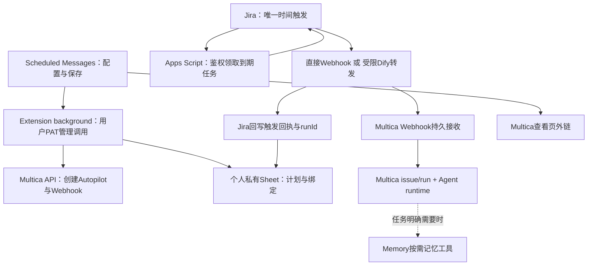

# Schedule Message → Multica：第一阶段接入计划

日期：2026-10-29｜来源：E-136｜状态：代码已实现，待真实 Jira / PAT / Apps Script 部署验证。设计文档保留到部署完成后再归档。

## 决策与结论

**可行：扩展使用每位用户自己的 PAT 调 Multica HTTP API，自动创建一个仅有 Webhook trigger 的 Autopilot，Jira 继续作为唯一时间触发源。** API、请求字段、Webhook 返回值和查看页路由已由 Multica 官方文档与本地源码交叉确认。无需在扩展运行 CLI，也不需要把 PAT 交给 Memory Service。

这里的“可行”是接口契约可支持，不是已完成真实部署端到端验证。尚缺：用户 PAT 下实际权限、Jira 出站可达性、GAS 安全领取改造及部署、真实 runtime 能力与成本验收。

**可以实现“已有账号、PAT、可用 Agent/runtime 的用户，不离开 Scheduled Messages 完成绑定和创建”。不能承诺全新用户只输一个 token，就凭空拥有 Agent、工具登录和在线执行环境。** 首次生成 PAT 仍需 Multica Settings → API Token；无 Agent/runtime 时明确引导初始化，不自动安装 daemon、代用户选择付费模型或扩大工具权限。

本阶段不迁 Multica cron，不重写 Memory Thinking，不迁 Roadmap/Outreach/AR，不自动搬旧任务，不复制完整任务控制台。

## 两个具体用户场景

### A. 用户已有 Multica，第一次启用“帮我做”

1. 在 Scheduled Messages 管理页点“配置 Agent Task”。右侧配置区展示“连接你的 Multica”，默认官方服务，可展开自托管地址。
2. 粘贴 PAT，点“验证连接”。后台调用 `/api/me`，显示账号；列出该 PAT 可访问的 workspace。禁止拿扩展运行机器的 Multica 登录身份代替此人。
3. 用户选 workspace、已有 Agent、可选 project；展示 Agent 的运行环境与可用性。只有通过校验才显示“可创建任务”，网络失败、无权限、runtime 离线分开解释。
4. 创建“每周一 09:00 检查 Epic 估时”的 Agent Task。用户只写任务、边界、周期；保存时扩展自动创建对应 Autopilot 和 Webhook，并接好 Sheet/Jira。
5. 保存回执：“已安排，时间由 Jira 触发；执行与结果在 Multica”。此次保存不立即执行。
6. 到点 Jira 投递，Sheet 记录“已送达”；用户点击行内“查看执行”进入 Multica 的 Autopilot 历史。已取得 issue_id 时再提供“本次任务”。

### B. 创建成功但 Sheet 写回失败

用户看到“Multica 已创建，计划尚未启用”，不会误以为全部完成。点“继续配置”复用已记录的 autopilotId/triggerId；不会再建第二个同名 Autopilot。浏览器关闭后再次打开，依据持久化配置进度恢复。无法确定上一次 POST 是否成功时先对账，不能盲目重发。

配套 `scheduled-agent-multica-phase1-demo.html` 是离线交互示意，含成功、失败恢复、查看执行，不连接真实服务。

## 1. 核实到的 API 契约

证据版本：Multica 本地仓库 HEAD `885ef12232bf191753521a6ea617b12fc33fcc05`（只读查看）；线上官方文档访问日 2026-10-29。本地 checkout 不代表当前线上服务版本。不是根据 CLI 命令名称猜测 REST 路径。

公共来源：[Multica Authentication and tokens](https://multica.ai/docs/auth-tokens)、[Autopilots](https://multica.ai/docs/autopilots)、[Runs](https://multica.ai/docs/tasks)、[官方仓库](https://github.com/multica-ai/multica)。

| 操作 | 已核实 HTTP 接口 | 要点 |
|---|---|---|
| 确认账号 | `GET /api/me` | `Authorization: Bearer <用户PAT>` |
| 可访问工作区 | `GET /api/workspaces` | 保存 id 和 slug；不能硬编码当前 E 的 workspace |
| 选择 Agent / project / runtime | `GET /api/agents`、`GET /api/projects`、`GET /api/runtimes` | 工作区请求带 `X-Workspace-ID`；列表可见不等于具有调用权限，最终写接口仍须校验 |
| 创建 Autopilot | `POST /api/autopilots` | title、description、assignee_type、assignee_id、execution_mode；project_id 可选；默认 active |
| 获取/编辑/归档 | `GET/PATCH/DELETE /api/autopilots/{id}` | 详情含 triggers、权限字段；DELETE 为归档语义；不等于取消正在执行的 run |
| 创建 Webhook | `POST /api/autopilots/{id}/triggers` | `kind=webhook`，provider 默认 generic；返回 id、webhook_path、webhook_url（可能 null） |
| 控制 trigger | `PATCH /api/autopilots/{id}/triggers/{triggerId}` | `enabled` 控制未来接收；创建时默认 enabled，不能假设 create 支持 disabled |
| 轮换入口 | `POST /api/autopilots/{id}/triggers/{triggerId}/rotate-webhook-token` | 旧 URL 立即失效；不能当成例行 GET |
| 执行历史/单次记录 | `GET /api/autopilots/{id}/runs`、`GET /api/autopilots/{id}/runs/{runId}` | run 可能带 issue_id/task_id，允许字段为空；分页读取 |
| 到点触发 | `POST /api/webhooks/autopilots/{token}` | bearer URL，无需再附用户 PAT；`Idempotency-Key` 贯穿 Jira/Dify |
| 停止执行（后续 UI 可接） | `POST /api/tasks/{taskId}/cancel` | taskId 不是 Webhook 返回的 autopilot runId；第一阶段从 Multica 页面操作 |

工作区鉴权统一使用 `X-Workspace-ID`，不要同时附另一个工作区的 `X-Workspace-Slug`（本地中间件优先 slug）。API base 与 Web app base 分别配置：官方 API 示例为 `https://api.multica.ai`，不能据此猜测所有自托管站点的网页域名。

创建示例（字段占位，不包含真实 ID 或凭据）：

```http
POST /api/autopilots
Authorization: Bearer <PAT>
X-Workspace-ID: <workspaceId>
Content-Type: application/json
```

```json
{
  "title": "Personal AI · Epic 估时检查 · <binding-short-id>",
  "description": "用户保存的任务与执行边界。来源标记 PAI_BINDING:<bindingUuid>。到期信息来自本次 webhook payload。",
  "assignee_type": "agent",
  "assignee_id": "<selectedAgentId>",
  "execution_mode": "create_issue",
  "project_id": "<optionalProjectId>"
}
```

```http
POST /api/autopilots/<autopilotId>/triggers
```

```json
{"kind":"webhook","provider":"generic","label":"pai:<bindingUuid>"}
```

不传 cron_expression/timezone，不创建 schedule trigger。每条重复计划只创建一套 Autopilot+Webhook，之后每次到点创建新的执行，不是每次执行重建 Autopilot。issue_title_template 若使用，仅支持 `{{date}}`，不要自创模板变量。

创建响应直接返回 Webhook；后续有写权限的详情请求也可拿到，读取权限者被脱敏。优先使用服务器返回的 webhook_url；为空时以已验证 API origin + webhook_path 组装，校验 HTTPS、允许的 host 和固定路径前缀。查看链接固定为 `{webAppBase}/{workspaceSlug}/autopilots/{autopilotId}`；具体 issue 使用同工作区 `/issues/{issueId}`。链接中永远不带 PAT/Webhook token。

### 接口层实际缺口

- 没有看到 CreateAutopilot 的 clientId/idempotency 字段，不能把 Webhook 的幂等能力误用于创建管理 API。
- 没有一次事务原子创建“Autopilot + Webhook + Sheet 行”的接口。
- 本轮未证实一个无副作用的“完整试运行”API；验证连接只做读取，真正 webhook 测试会创建工作，必须标清动作。
- PAT 是账号级访问凭据，可触达该账号有权限的多个 workspace，选 workspace 是应用约束，不是 token 自动降权。
- 自动创建 Agent 不在本阶段；列出已有 Agent 并不证明对应模型凭据、Jira 工具身份都可用。

## 2. 架构和职责



- **计划真源**：Sheet，仍由 GAS 计算匹配和周期。Multica 不保存第二份周期调度。
- **任务指令真源**：扩展保存至 Autopilot description；Sheet 保留用户编辑内容和 revision。若内容存在到期变量，payload 另带该次 effectiveTask，并在 runbook 定义来源和只允许的替换规则。
- **执行真源**：Multica。Memory 不接收这类新任务的 execute 请求，不创建 shadow action、不用 runtime-status 作为本类任务状态。
- **凭据归属**：PAT 仅用于用户打开扩展时的管理 API；Jira 的无人值守投递使用每任务 Webhook capability。关闭 Chrome 不应停止已接好任务的到期投递。
- **传输**：默认优先直接 Jira → Multica；只在 Jira 实测不可达而 Dify 可达时使用 Dify。不得自动改变服务器/工作区来“绕过”拒绝。

## 3. 用户配置与多用户隔离

管理页内联配置卡，无需跳 Options：服务地址（高级）、PAT、账号回执、workspace、Agent、可选 project。断开连接、验证失败、权限撤销和 token 过期均有明确状态。没有 Agent 时给设置入口，不能显示已开启。

- PAT 默认保存在 `chrome.storage.session`，不跨浏览器重启持久保存；用户可明确选择“记住此设备”，再放仅 TRUSTED_CONTEXTS 可读的 local 存储。第一阶段上线前评估该访问级别对现有扩展 content scripts 的影响；不要盲目全局收紧造成其他功能故障。更强本机加密需要桌面密钥库等额外方案，不声称 local 是安全保险箱。
- 调用集中在 extension service worker：限制调用方为扩展管理页、操作 allowlist、已绑定 origin；不能暴露任意 URL + 任意 header 的 fetch 代理。PAT 不进入 contentScript、postMessage、Sheet、GAS、Dify、Memory、console、错误回执或导出备份。
- 每个连接以 `(apiOrigin, multicaUserId, workspaceId)` 命名空间隔离；每个任务绑定固定 owner/connection，不跟随全局“当前 workspace”漂移。
- 切 workspace/账号只影响新任务；旧任务继续绑定旧连接，编辑需要对应权限。失去权限时显示只读/需重新认证，不能静默用另一账号更新。
- 断开扩展只删除本机 PAT，**不会自动停止已存在周期/Webhook**；界面给出此准确说明。“停止全部关联计划”是独立的显式操作。
- PAT 撤销/过期不应被当作 Webhook 自动撤销：后者有自己的权限与生命周期。需要停止时禁用 trigger/归档，不只删本机 token。
- 初次 token 获取、创建 workspace/runtime、模型或 Jira 工具登录不在无需打开 Multica 的承诺内。PAT 不能用来给外链自动登录，网页可能仍要求用户正常登录。

Chrome 官方确认扩展 service worker 在 host_permissions 下可跨域请求，content script 不具备相同豁免；本仓库已声明广泛 host_permissions，但仍需安装态验证，不能仅凭普通网页 CORS 成功/失败判断：[Chrome network requests](https://developer.chrome.com/docs/extensions/develop/concepts/network-requests)、[Storage API](https://developer.chrome.com/docs/extensions/reference/api/storage)。

## 4. Webhook 秘密如何抵达 Jira：上线前必须解决

**当前 GAS 匿名 Web App 的领取接口，不能原样返回新增 Webhook URL。** Webhook URL 是“持有即可触发”的凭据，隐藏 Sheet 列不等于访问隔离。不能因为它权限比 PAT 小就公开。

第一期推荐限定 **每人自己的私有 Sheet + 自己的 Jira executor rule**：

1. 在私有 `_AgentBindings` 表保存绑定 ID 与每任务 webhook URL；普通 Messages 只放非秘密引用。隐藏表只防误操作，所有获 Sheet 读取权的人仍可能得到入口，因此共享可读表不满足此方案的隔离前提。试点前检查共享权限；权限无法检查时不能宣称安全就绪。
2. 为此新任务分支的 GAS 领取及回执引入专用 scheduler capability 校验，任何匿名诊断/列表/日志接口不得返回秘密。旧无认证入口不得先领取、再经其他 action 旁路取秘密。
3. GAS Web App 通常不能按任意请求 header 读认证，现有 Jira→GAS GET 又是为规避 POST ContentService 重定向问题；因此不能设计一个虚构的“加 Authorization header 就好了”。最小兼容方案是高熵 GET capability 参数，存于私有配置与 Jira 受保护配置；接受前必须验证 URL/审计/代理日志脱敏和账号可见范围。若组织不允许 query bearer，则此方案停止上线，改用验证过的认证 POST 入口或独立密钥代理，另立范围，不偷偷新增 Memory 中转。
4. Dify 模式中 URL 只流经受控跳板，禁止任意 URL 代理：只允许配置的 Multica HTTPS origin 和 Webhook 路径，不跟随跨源重定向，不向其传 PAT。其管理者/运行日志也属于凭据可见边界。未证明日志脱敏前，不能开放广泛用户。
5. 不向用户展示/复制 webhook；Jira 规则审计不记录完整请求、payload、URL 或 token。泄露后走轮换与停用，不靠重命名。

这是一处**需要实现和验证的上线门槛**，不是已经存在的安全能力。若必须支持“多人共享同一 Sheet、每人 token 严格隔离”，需专门的凭据代理/受控 vault，不能声称单靠前端 PAT 和隐藏列就完成。第一阶段不把它伪装为无成本能力。

## 5. 创建、恢复与编辑状态机

本地配置日志（与 user/workspace 隔离）记录以下非秘密状态；Sheet 使用 Paused 行，不能放未识别的 Status 值让旧代码误领。

`draft → sheet_paused → autopilot_created → webhook_created → binding_written → ready`

- 保存前生成稳定 bindingUuid。先创建不可领取的 Sheet 行，记录 messageId、内容 hash、revision，再 POST Autopilot。
- Autopilot 创建默认 active，但没有 trigger 不会自己按时执行。拿到 id 后立即持久化，再创建 webhook；URL 尚未发给调度方，不发测试调用。
- trigger 默认 enabled，生成后仅扩展持有；写入私有绑定表并核对。最后才将 Messages 行激活；Jira 配置不完整则保留 Paused。
- API 返回后尽快落配置进度；浏览器终止、Google 写入失败、网络丢响应均可恢复。每个 binding 单写者锁，禁止双击产生并行创建。
- 创建 POST 响应未知时，通过本 workspace 的 Autopilot 列表、creator 和 description 中的唯一 `PAI_BINDING:<uuid>` 找回；trigger 用详情中 kind+label 找回。名称本身不唯一，不作唯一依据。
- 没找到不立即视为没创建：可能原请求仍在处理；有限重查后停在“创建结果待确认”，提供重新检查/人工选择，不自动再 POST。没有服务器唯一约束就不能承诺跨设备 exactly-once 创建。
- 失败回滚优先暂停本任务/Autopilot，保留已创建对象与恢复入口；不删除不确定归属对象。用户放弃时仅归档本绑定创建的对象，不动其他 Autopilot。

编辑：先暂停 Sheet 新领取，明确已投递 run 保持原快照；更新 Autopilot description/Agent 和 Sheet revision，读回校验后恢复。只改周期仍只改 Sheet。外部手改 Autopilot 导致内容 hash 不同，提示冲突，不默默覆盖。暂停计划同时禁止 Sheet 新领取，并禁用该 trigger；恢复需两侧成功后才显示 Active。停用未来触发不等于停止当前 run，本阶段通过外链进入 Multica 单独停止。

删除：先停止未来触发；归档本绑定 Autopilot，保留历史查看关联；失败时保留“待停用”可重试记录。切换 provider 必须处理已经 claimed/UNKNOWN/已接收的旧 occurrence，禁止新旧双投。

## 6. 到期投递与确认

建议新增 provider 分支 `Agent_Provider=multica`（默认旧行 legacy_memory），不要把所有 AgentTask 行强制切走。绑定至少含：

```text
bindingUuid, apiOrigin, webAppOrigin, multicaUserId, workspaceId, workspaceSlug,
agentId, projectId?, autopilotId, triggerId, messageId, contentRevision,
provisionState, webhookSecretRef, createdByConnection, remoteUpdatedAt
```

multica分支必须绕开当前表单的Memory执行器加载、OpenClaw前置检查，以及GAS的Memory webhook配置校验；仅增加下拉选项仍会被旧校验阻止。Jira/GAS云端入口仍必需，不能把“移除Memory依赖”误做成移除时间调度配置。

这些是拟新增集成字段，不是 Multica 已有 API 字段。每次执行另存 `executionKey, scheduledFor, revision, deliveryId, autopilotRunId, issueId?, taskId?, dispatchState, lastCheckedAt`。所有更新/重试都固定工作区与 binding，不随列表当前筛选变化。

Jira 领到任务后，使用稳定 `Idempotency-Key = pai:<bindingUuid>:<现有executionKey>`，若原key过长，使用上述稳定组合的SHA-256编码满足下游长度限制；同一 occurrence 的网络重试必须复用；不能用尝试时间生成新 key。payload 仅包含必要的 source/messageId/scheduledFor/revision/到期变量，不传用户全部记忆、PAT、Google token 或 RingCentral sender 密钥。

Multica webhook 200 不是统一成功：

| 响应 | Sheet/集成行为 |
|---|---|
| `accepted` + run_id | 记“已送达 Multica”，保存 IDs；确认的是投递，不是业务完成 |
| `duplicate` + run_id | 关联原执行，不再另建；按原记录状态展示 |
| `duplicate` 但缺 run_id | 不伪造送达完成，保留待对账；打开扩展后按 delivery/历史核实 |
| `skipped` / `ignored` | 显示拒绝/跳过原因；不能因 HTTP200 增加业务成功数 |
| 网络超时/响应无法解析 | UNKNOWN，不换 key盲重试；有限同 key重试与对账策略 |
| accepted 后 runtime 执行失败 | Multica 执行状态失败，不能撤销历史“送达”事实 |

保持 `Exec_Count` 的旧消费语义时必须标注它是触发确认次数，不能改称 Agent 成功次数。结果状态独立，不再借旧 `Agent_Last_*` 或 Memory run 假装执行成功。后台不开 Chrome 时不保证自动同步最新执行状态；查看页外链仍有效，打开管理页可按需 GET runs。第一期通知以 Multica 原生 issue/结果为准，原 Bot/AsMe 模板、空结果静默和 AR 写回不自动兼容；带这些要求的旧任务继续 legacy，不能默默降级。

若走 Dify，必须新建/调整分支解析 Multica `status` 和 IDs，不能套用旧 `outputs.accepted` 对 Memory 的判断；两条路径最终返回同一集成回执类型。

## 7. 拟修改位置与交付阶段

| 部位 | 后续实施职责 |
|---|---|
| `ScheduledMessagesManager.tsx` / `agentTaskExecutor.ts` / `types.ts` | 内联认证、workspace/Agent选择、provider分支、保存进度、外链 |
| 拟新增 `MulticaClient` / 连接存储与配置协调器 | 明确 API DTO校验、权限错误、namespace、创建恢复；background封装操作allowlist |
| `ScheduledMessageService.ts` / Sheet schema / ConfigSync | 非秘密绑定字段、私有绑定表、复制Sheet时清除绑定并要求重连 |
| `app-script-template.gs` | multica领取分支、鉴权、provider绑定校验、claim/confirm IDs、不泄露秘密；按仓库规则升级版本 |
| `jira-rule-template.json` / JiraAutomationService | 投递路由、Idempotency-Key、严格回执解析、日志脱敏 |
| Dify配置（仅需要时） | 受限转发，传播key，返回Multica回执，不含用户PAT |
| `TaskCenterLedgerSync.ts` / 列表状态汇总 | 对multica新任务跳过Memory执行登记与runtime-status；旧任务不受影响 |

P0 契约验证：使用专门测试账号、私有Sheet与无副作用任务，验证PAT权限、页面外链、真实部署返回结构；Jira原环境验证网络；完成GAS秘密路径设计。未通过不得进入广泛启用。

P1 扩展绑定与创建恢复：实现配置/绑定、暂停态创建、恢复、权限撤销；不执行真实任务也能验证管理API契约。

P2 端到端投递：Jira唯一时间源，Multica create_issue；使用一次只读运行验证连接、结果、取消操作；没有 schedule trigger。

P3 小范围开放：只对新建且不依赖旧通知/AR的任务开启；试点稳定后再讨论旧计划迁移，不在本计划自动执行。

本阶段完成标准：两个不同用户各自绑定不同workspace，关闭Chrome和停用Memory后，Jira仍能把各自新任务送往正确Multica；用户能通过安全外链查看执行。任何用户不能借本扩展读取另一用户PAT或重绑定其任务。

## 8. 验证矩阵、风险与停止条件

实施时要求：

- API测试：PAT错/过期/撤销、workspace不匹配、Agent无调用权、creator离开workspace、配额拒绝、webhook_url缺失、返回字段漂移。
- 创建恢复：每个阶段断网/关页/Google失败、双击/双tab、创建响应丢失、不确定结果不盲建、半成品不能被Jira领取。
- 投递：重复key只关联一次；skipped/ignored不是成功；未知回执不换key；不同occurrence允许新run；并发编辑保留已接受快照。
- 安全：PAT/URL不出日志与导出；匿名GAS无法取得或领取Multica任务；公共/共享Sheet拒绝个人隔离模式；Dify任意host/重定向被拒；workspace切换不串号；复制Sheet不继承可用秘密。
- 真实安装态：扩展background跨域、权限提示、重启后的凭据恢复策略、外链需正常登录；不以纯网页测试代替。
- 真实Jira：一分钟领取、补偿窗口、Timeline触发维持原行为；无Multica schedule；暂停未来不错误声称停止当前。
- 实际取消：从Multica停止受管run后不再继续工具调用；已发外部请求不声称撤销。
- 退出/回滚：暂停Jira侧新投递，保留历史run关联；只将确认未投递的任务切回legacy，UNKNOWN先对账。

停止条件：无法保护Webhook秘密、部署不支持所需API、无适合runtime、关键权限/通知只能靠共享管理员凭据，或必须新增大型控制平台才能接通。届时先维持旧provider，不靠“接口大概兼容”上线。

这一步价值主要由确定性契约与E2E证明，不需要为HTTP转发引入LLM judge。生产实现遵守AGENT.md相关Tier与文档更新：`scheduled_messages_manager.md`、`task_center.md`、`agent_executor_runtime.md`、`docs/index.md`；部署后再移除/归档此规划说明。当前仅设计，未声称生产测试通过。

## 9. 执行器剩余用途：不能直接整体删除

此次扫描依据为运行源码，不把“名字带反思”一概当作外部Agent。

| 入口/能力 | 当前依据 | 判断/后续归属 |
|---|---|---|
| 定时 AgentTask / Task Center agent、dev、agent push | `routes/agentTasks.ts`、`routes/taskCenter.ts:151` | 用户委派，可逐步由Multica管理；本期只Schedule新任务 |
| AR即时刷新/重复数据任务 | `MemoryServiceClient.executeAgentTask`、Dify README的AR直连说明、agentTasks中arBindingId | 需要结构化artifact与绑定写回，不能只换Webhook |
| Roadmap“Agent创建Jira” | `src/contentScriptRoadmap.ts:2178` | 外部写操作；经扩展bridge到Memory，轮询后按artifact做draft/Jira映射；与确定性直建路径区分。后续可迁Multica，但必须保留结果契约与部分成功写回，不归入纯内在思考 |
| `/ask`证据不足后的外部查证 | `routes/ask.ts:2661`、EvidenceResolutionPlanner | 外部工具能力，保留可替换执行出口 |
| 反思提出的外部研究/行动 | ReflectionThreadService executorDefaults.reflection_research、ReflectionWorker delegate action | 内部思考提出建议，外部证据收集/行动再委派，不能混为一个权限域 |
| Outreach缺证补查、确认后续跑 | OutreachEngine、confirmRequests、EvidenceWatchContractService | 与对话/确认状态有关，不能只迁周期触发 |
| 消息规则自动化 | MessageRuleAutomationPlanner delegate_openclaw | 可能是代表用户做事，保留外部执行管理与授权 |
| A2A入口、远程Worker、MCP记忆工具 | routes/a2a、agentWorkers、executorFactory、AcpExecutor | A2A是另一执行入口；Worker是执行通道；MCP提供记忆能力，不是全部都该删除 |
| 做梦/本地反思核心 | GenerativeReplay:289、ReflectionResearcher:202、ReflectionWorker:229 | **已经直接调用LLMClient**。整理记忆不需要先发外部AgentTask |

第一阶段不移除 Options 原执行器，也不改变现有reflection_research默认值。只在新的Schedule Multica模式中隐藏不相关选择。保留provider显式标签，避免用户误以为所有执行已归Multica。

## 10. Memory Thinking：建议内化职责，不先押注实现方式

推荐的产品边界：用户看到“记忆中心正在梳理/发现矛盾/形成线索”，而非要求用户管理一个外部执行器。**这种内化体验不要求一切运行在同一个进程，也不要求持续让LLM无限思考。**

概念结构：

`新证据/闲时触发 → 受预算约束的Thinking session → 检索/比对/候选记忆 → 既有写入治理与来源记录`

若需要访问外部系统、创建Jira、发消息，则提出单独的外部任务，由具有对应身份的执行器/Multica处理；反馈结果作为证据回到记忆。Memory保留反思/做梦等内部周期，不因用户任务迁Multica就把整个memory_cron停掉。

| 实现方向 | 适配此项目的优点 | 代价 | 建议 |
|---|---|---|---|
| 现有LLMClient + 明确工作流 | 已有数据边界、预算、评测，改动小 | 多步自主查证灵活性有限 | 保留为基线与多数常规整理路径 |
| 嵌入Pi agent-core（受控worker） | TypeScript工具循环、上下文变换、事件、取消；可只暴露记忆工具 | 仍需自行提供调度、隔离、权限、预算、持久化与写入治理 | 后续用一个只读反思场景做实验，非本期依赖 |
| 嵌入完整Pi coding-agent SDK | 现成session、工具与资源机制 | 默认cwd资源发现、文件/工具能力更宽，配置和身份隔离成本高 | 不作为“整理记忆”的默认底座 |
| 继续外部Gateway/ACP | 工具和运行环境成熟，故障可隔离 | 协议/账本/凭据耦合、延迟和运维多一层 | 保留给外部查证及行动，不让所有梦境都绕外部 |

Pi是可嵌入harness，不是现成的记忆认知架构。官方当前仓库 `earendil-works/pi` 的 agent-core 支持工具执行与事件流，coding-agent SDK 可嵌入Node/Bun并管理session；SDK默认发现工作目录资源，需显式控制。不要盲用旧包名或默认coding tools：[Pi agent-core](https://github.com/earendil-works/pi/tree/main/packages/agent)、[Pi SDK](https://github.com/earendil-works/pi/blob/main/packages/coding-agent/docs/sdk.md)。

建议未来的 ThinkingRunner 只暴露 user-scoped `recall/search/readEvidence/proposeMemoryUpdate` 等工具；不能直接开放数据库文件、任意shell、Jira写入或消息发送。写入继续走已有注入检查、来源、冲突与回滚机制；普通可逆内部整理自动推进，高责任事实/外发才按既有边界要求确认。每个session明确用户、证据版本、预算、deadline、停止信号与去重键；独立worker隔离故障，不把Memory API阻塞。

**需要验证再决定是否采用Pi**：以同一模型、同一工具与预算，比较现有工作流和Pi在“新旧证据冲突查证”的质量/成本。建议20–30个有来源的case，覆盖矛盾、缺证、注入、跨用户诱导、工具超时；成功标准为越权/无来源自动写入0，证据有效率不低于基线，质量提升可复现，成本在预设预算内。若质量无收益、只是延迟/成本上升就停止引入。实现时新增对应eval suite，运行并出报告；触及记忆读写还需六能力回归。此处是实验建议，未执行。

### dots / Instinct 能说明什么

用户提到的dot，这里按OpenAI官方ChatGPT dots理解。官方区分“只读主动研究与私有笔记”和“用户授权任务的行动权限”；这支持我们做职责边界的参考，不证明其采用Pi或某个同进程harness。[OpenAI Tasks and memory](https://learn.chatgpt.com/docs/dots/tasks-and-memory)。Instinct官网说明持续理解用户工作并使用电话/电脑，未公开足以验证其内部harness的源码；本项目已有E-72/记忆常驻页等对标材料，不再把黑盒猜测当实现事实。[Instinct](https://instinct.com/)。

因此我建议：**现在做Multica第一阶段；内部Thinking先保留现有LLM工作流和外部出口，随后做窄范围Pi实验。** 不把“用户体验内化”与“一次性替换全部执行器”绑定。

## 11. 与既有规划及证据的关系

- `agent-task-ledger-plan.md` 主张复用Memory统一任务账本；本计划对用户显式Schedule AgentTask提出不同管理归属，内部反思、Outreach、既有任务不随本阶段迁移。
- `agent-memory-control-tower-plan.md` 的产品边界提醒仍成立：避免把私人记忆系统扩张成另一套通用任务编排平台。
- `memory-like-humen-self-thinking.md`、常驻one-pager/睡眠相关plan已覆盖内部思考问题；本次只给分层与实验建议，不另建竞争性的完整认知重构路线图。
- `to-verify.md` 记录过反思后台耗费与dreaming失败，说明内部harness选型必须有预算/睡眠/失败隔离，而非靠“持续运行”表达智能。本轮不把旧待验证记录当作当前线上事故。

源码证据索引（Multica相对其仓库根）：`server/internal/handler/autopilot.go:359/808/1514`、`autopilot_webhook.go:326`、`server/cmd/server/router.go:2004`、`internal/middleware/auth.go`、`packages/core/api/client.ts:4112`、`packages/core/paths/paths.ts:35`。认证、URL、状态以该源码版本为事实依据，生产部署需P0复核。

来源属性：Multica/Chrome/OpenAI/Pi/Instinct链接均为一手材料，访问2026-10-29；除源码固定SHA外多为未标发布日期的滚动文档。产品文档证明声明的能力，不证明本项目部署/集成成功；对Thinking分层与选型的判断是本报告建议，不是厂商共识。
